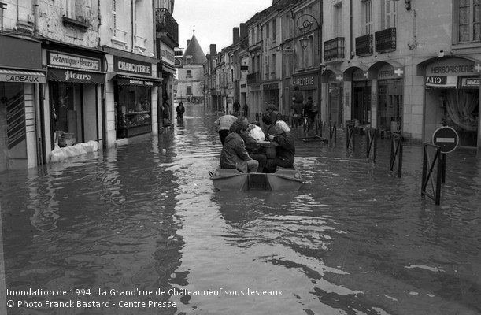

## Pourquoi un observatoire ?

::: {.columns}

::: {.column width="55%"}
- L'inondation est le **premier risque naturel** en France
- Elle menace des vies, des logements, des emplois
- Les bassins de la Vienne et du Clain ont connu des crues par le passé
- Objectif : **« mieux savoir pour mieux agir »**
:::

::: {.column width="45%"}
{width=100%}

{width=100%}
:::

:::

::: {.notes}
Rappeler que le territoire a été relativement épargné ces dernières années, mais que les événements récents sur des territoires voisins incitent à rester vigilant.
:::

## La vulnérabilité, c'est quoi ?

Ce qui peut être touché par une inondation, et à quel point.

::: {.cartes}

::: {.carte}
### Les personnes
Habitants, personnes âgées, ménages modestes, établissements accueillant du public
:::

::: {.carte .vert}
### Les biens
Logements, bâtiments, routes, réseaux, patrimoine
:::

::: {.carte .marine}
### Les activités
Entreprises, emplois, agriculture, services utiles en cas de crise
:::

:::

## Une « crue centennale », c'est quoi ?

::: {.columns}

::: {.column width="40%"}
<span class="gros-chiffre">1 sur 100</span>

chance de se produire **chaque année**
:::

::: {.column width="60%"}
- Ce n'est **pas** « une crue tous les cent ans »
- Elle peut survenir deux années de suite
- Sur 30 ans, la chance d'en connaître au moins une est d'**environ 1 sur 4**
- Tous les indicateurs de l'observatoire s'appuient sur cette crue de référence
:::

:::

::: {.notes}
Calcul : 1 - (0,99 à la puissance 30), soit environ 26 %. C'est une comparaison utile pour un public qui pense que la crue centennale ne se produit qu'une fois par siècle.
:::

## Le projet en une phrase

::: {.callout-note appearance="simple"}
Un site **gratuit et ouvert à tous** qui montre, sur une carte et en chiffres, qui et quoi est exposé aux inondations, commune par commune.
:::

::: {.incremental}
- Réalisé par l'EPTB de la Vienne et le CEREMA
- Avec l'appui de collectivités et de services de l'État
- Financé dans le cadre d'un programme de prévention des inondations
:::

## Ce que l'on peut faire sur le site

::: {.cartes}

::: {.carte}
### Explorer la carte
Se déplacer, zoomer, passer en vue 3D, changer de fond de plan
:::

::: {.carte .vert}
### Chercher un lieu
Saisir une adresse ou une parcelle pour voir si elle est concernée
:::

::: {.carte .marine}
### Lire les chiffres
Consulter un tableau et un graphique pour chaque indicateur
:::

:::

<!-- Capture d'écran possible : Images/capture_carte.png -->

## Les indicateurs

Des mesures simples, calculées selon **une méthode nationale**.

::: {.columns}

::: {.column width="50%"}
**Exemples**

- Nombre de personnes en zone fortement inondable
- Nombre de logements en zone inondable
- Communes disposant d'un plan communal de sauvegarde à jour
:::

::: {.column width="50%"}
**Six thèmes**

- Population
- Urbanisation
- Économie
- Infrastructures
- Agriculture
- Environnement
:::

:::

## D'où viennent les données ?

```{mermaid}
flowchart LR
  A["Données publiques<br>IGN, INSEE, CEREMA"] --> B["Indicateurs calculés<br>selon une méthode nationale"]
  B --> C["Cartes, tableaux<br>et graphiques"]
  C --> D["Un site web<br>ouvert à tous"]
```

::: {.legende}
BD TOPO (IGN), Fichiers fonciers (CEREMA), GeoSIREN (INSEE)
:::

## Comment le site est construit

**Quarto** : un outil qui transforme des fichiers texte et des données en site web.

::: {.incremental}
- On écrit les pages une fois, le site se **reconstruit automatiquement**
- Pas de serveur à entretenir : le site est publié gratuitement
- Quand les données changent, on relance la fabrication et tout est à jour
:::

::: {.notes}
Image possible : une recette de cuisine. On écrit la recette une fois, on peut la refaire à l'identique à chaque nouvelle livraison de données.
:::

## Les quatre grandes étapes

::: {.cartes}

::: {.carte}
### 1. Préparer
Rassembler les données, les nettoyer, les convertir en cartes
:::

::: {.carte .vert}
### 2. Écrire
Une page pour chaque indicateur, selon un même modèle
:::

::: {.carte .marine}
### 3. Fabriquer
Quarto assemble les pages, les cartes et les graphiques
:::

::: {.carte}
### 4. Publier
Le site est mis en ligne et accessible à tous
:::

:::

## Un défi : des données très volumineuses

::: {.columns}

::: {.column width="50%"}
Les limites de parcelles couvrent tout le territoire.

Pour que la carte reste **fluide**, il faut alléger les fichiers sans perdre l'information utile.
:::

::: {.column width="50%"}
<span class="gros-chiffre">600 Mo</span>
&nbsp;fichier d'origine

<span class="gros-chiffre">110 Mo</span>
&nbsp;après allègement

::: {.legende}
Exemple de la couche des parcelles
:::
:::

:::

## Un défi : rendre les chiffres lisibles

Certaines valeurs très faibles sont **masquées** pour protéger les données personnelles. Le site les présente de façon claire.

| Couleur | Signification |
|:--|:--|
| <span class="pastille" style="background:#d9d9d9; color:#1e293b">gris</span> | Non concerné |
| <span class="pastille" style="background:#fff; color:#1e293b; border:1px solid #cbd5e1">blanc</span> | Aucun |
| <span class="pastille" style="background:#ffd5d5; color:#1e293b">rose clair</span> | De 1 à 19 |
| <span class="pastille" style="background:#ff0000">rouge</span> | 100 et plus |

## Deux regards sur le risque

::: {.columns}

::: {.column width="50%"}
<span class="pastille" style="background: rgb(0,158,224)">Débordement de cours d'eau</span>

La rivière sort de son lit et inonde les terres voisines.
:::

::: {.column width="50%"}
<span class="pastille" style="background: rgb(151,190,13)">Ruissellement</span>

La pluie ruisselle sur les sols et s'accumule dans les points bas.
:::

:::

Un **interrupteur** dans la barre du site permet de passer de l'un à l'autre. Les couleurs changent pour s'y retrouver.

## Une entrée en matière

- Une **vidéo plein écran** ouvre le site
- Elle montre une vallée avant, pendant et après une crue
- Un bouton permet d'entrer dans l'observatoire à tout moment
- Elle n'est montrée **qu'une seule fois** par visite

## Ce qui a demandé du travail

::: {.cartes}

::: {.carte}
### Des fichiers lourds
Réduits pour que la carte s'affiche vite
:::

::: {.carte .vert}
### Beaucoup de pages
Organisées en deux thèmes avec un seul menu
:::

::: {.carte .marine}
### Des écrans variés
Un affichage adapté aux ordinateurs comme aux téléphones
:::

:::

## Et maintenant ?

::: {.columns}

::: {.column width="50%"}
**Aujourd'hui**

Grand Poitiers et quelques communes le long de la Vienne, dont Châtellerault
:::

::: {.column width="50%"}
**Demain**

- Étendre à tout le territoire Vienne - Clain
- Compléter les pages d'indicateurs
- Proposer des fiches à télécharger
:::

:::

## Merci

::: {.columns}

::: {.column width="60%"}
**Le site**

[mvince11.github.io/Observatoire-eptb-](https://mvince11.github.io/Observatoire-eptb-/)

**Contact**

contact@eptb-vienne.fr
:::

::: {.column width="40%"}
<span class="gros-chiffre">Questions ?</span>
:::

:::

## Annexe : les outils utilisés {.smaller}

Pour les personnes qui souhaitent aller plus loin.

| Outil | À quoi il sert |
|:--|:--|
| **Quarto** | Fabriquer le site à partir de fichiers texte |
| **R** | Préparer les données et produire les tableaux |
| **QGIS** | Traiter les données géographiques |
| **MapLibre** et **PMTiles** | Afficher la carte interactive |
| **Plotly** | Dessiner les graphiques |
| **GitHub Pages** | Héberger le site gratuitement |